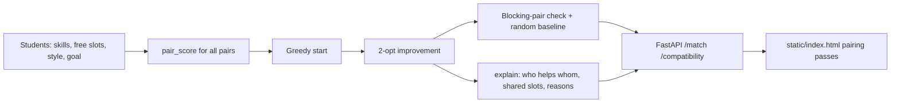

# Study Buddy Matcher


Study groups fail for boring reasons: the two people are equally stuck on the same chapter, or they never share a free hour. Study Buddy Matcher pairs students so that **each can help the other, they can actually meet, and they like to study the same way**, and it prints the reason on every pair.


## Pairing logic in one table
| Signal | What it measures | Weight |
|---|---|---|
| Mutual help | One is strong (4-5) where the other is weak (0-2), summed both ways | 5.0 |
| Shared free time | Overlapping slots in a 7-day x 3-part week (capped at 6) | 3.0 |
| Study style | Both prefer quiet, or both prefer chatty | 1.5 |
| Goal | Both preparing for an exam, or both studying long term | 1.0 |

A pair scores between 0 and 10.5. With an odd cohort, the student with the lowest overall compatibility joins the best-fitting pair as a third member.

## How the matching works
1. Compute the score of every possible pair (symmetric).
2. Build a first matching greedily from the best pair down.
3. Improve it with **2-opt**: for any two pairs `(a,b)` and `(c,d)`, try `(a,c)(b,d)` and `(a,d)(b,c)` and keep the better total. Repeat until nothing improves.
4. Count **blocking pairs**: two students who would both prefer each other to their assigned partners. Zero means the matching is stable.
5. Compare the total with the average of 50 random pairings.

On the bundled cohort of 28 fictional students: total score **123 against 84** for random pairing, with 1 blocking pair.



## Run it
```bash
python -m venv .venv && source .venv/bin/activate && pip install -r requirements-dev.txt
python scripts/generate_students.py                 # data/students.json is already committed
PYTHONPATH=src uvicorn buddies.api:app              # http://localhost:8000, docs at /docs
pytest -q && ruff check .
```
Docker: `docker build -t study-buddy . && docker run --rm -p 8000:8000 study-buddy`. Hosting: [DEPLOY.md](DEPLOY.md). Pure Python, no model files.

## Design decisions
- **A transparent weighted score, not a learned model** — a student can be told exactly why they were paired; with no outcome data, learning weights would only hide assumptions.
- **Skill gaps counted in both directions** — a pair where both help each other beats one where only one does, which is what makes a buddy rather than a tutor.
- **Shared time is capped** — six common slots are plenty; more adds nothing and would let availability drown out everything else.
- **Greedy + 2-opt instead of an exact matching algorithm** — near-optimal for a class of 30 to 200 in milliseconds, easy to read and test; the blocking-pair count says how far from stable it is.
- **Blocking pairs reported openly** — a stable matching may not exist for roommates-style pairing; showing the count is more honest than hiding it.
- **Odd cohort = a trio, not a leftover** — nobody is dropped; the least-connected student is placed with the best-fitting pair.
- **Reasons come from the score's own inputs** — the explanation cannot disagree with the ranking.
- **Seeded randomness** — same seed, same pairing (tested); "Try another pairing" changes the seed.
- **Visual system dealt with taste-skill**: palette "paper-grey-brass" (brass only as a fill, ink for text so contrast holds), Bricolage Grotesque + Hanken Grotesk, sharp pass-style cards.

## Dataset
`data/students.json`: 28 invented students with random skills (0-5 in six subjects), free slots, style and goal, from `scripts/generate_students.py` (seed 17). No real students. CC0.

## Limitations
- Weights are judgement calls; with real outcomes (grades, session ratings) they could be fitted.
- Skills are self-rated, which students inflate or deflate.
- Pairs only (plus one trio); study groups of four or more are not built.
- No time-zone handling: slots are plain day-parts.

## License
MIT.
