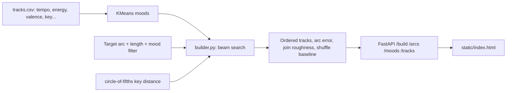

# Playlist Arc Builder


A good playlist has a shape: a warm-up that builds, a peak, a long cool-down. Shuffle ignores that. Playlist Arc Builder takes a **target energy curve** and picks tracks whose energy follows it, then joins them so the transitions sound smooth.


## What you control
| Control | Effect |
|---|---|
| Shape | Warm-up/peak/cool-down, steady focus, slow burn, rollercoaster, wind down (or custom points through the API) |
| Length | 15 to 120 minutes in the UI (5 to 240 via the API) |
| Moods | Restrict to Calm, Mellow groove, Uplift or Full throttle tracks (found by clustering, see below) |

## How it works
1. **Moods by clustering.** KMeans (k=4) on tempo, energy, valence, danceability and acousticness groups the library; clusters are named by their average energy.
2. **Target arc.** A piecewise-linear curve over the playlist's timeline gives the energy wanted at each moment.
3. **Beam search.** Keep the 12 best partial playlists, extend each with its 10 cheapest next tracks, repeat until the requested length is reached.
4. **Cost of a step** = squared distance of the track's energy from the arc + a transition cost made of tempo jump (per 40 bpm), key clash (distance on the circle of fifths; relative major/minor count as the same), valence swing, and a penalty for the same artist twice in a row.
5. **Compare with doing nothing.** Every result carries the arc error and join roughness of a random playlist of the same length.

On the bundled 200-track library (45 minutes, warm-up/peak/cool-down): arc error **0.06 against 0.21-0.27** for a shuffle, and join roughness **0.17 against about 1.3**, built in about 0.1 s.



## Run it
```bash
python -m venv .venv && source .venv/bin/activate && pip install -r requirements-dev.txt
python scripts/generate_tracks.py                 # data/tracks.csv is already committed
PYTHONPATH=src uvicorn arcmix.api:app             # http://localhost:8000, docs at /docs
pytest -q && ruff check .
```
Docker: `docker build -t playlist-arc . && docker run --rm -p 8000:8000 playlist-arc`. Hosting: [DEPLOY.md](DEPLOY.md).

## Design decisions
- **Beam search, not greedy or exhaustive** — greedy paints itself into a corner near the end of the arc; exhaustive search over 200 tracks is impossible; a small beam keeps good alternatives alive and runs in about 0.1 s.
- **Transition cost uses key distance on the circle of fifths** — adjacent keys and relative major/minor mix cleanly, so this is a cheap, standard proxy for "sounds good next to each other".
- **Energy is the arc, everything else is a join cost** — one number a person can draw a curve for, with the musical details handled automatically.
- **Moods from clustering instead of hand labels** — no labelling work, and the clusters adapt to any library; naming by mean energy keeps them readable.
- **Always report the shuffle baseline** — "0.06" means nothing alone; "0.06 against 0.21" does.
- **Seeded tie-breaking** — same inputs and seed, same playlist (tested).
- **Visual system dealt with taste-skill**: palette "sky-sand" (sky field, black ink, magenta accent, with a night set), Mona Sans + Geist Mono, round chips, an arc chart over the track list.
- **Invented library** — fictional titles and artists with synthetic audio features; nothing copyrighted and no audio files.

## Dataset
`data/tracks.csv`: 200 invented tracks in 8 genres with synthetic tempo, energy, valence, danceability, acousticness, duration, key and mode, from `scripts/generate_tracks.py` (seed 29). CC0.

## Limitations
- Features are synthetic; real libraries need audio analysis (or a streaming service's features) to fill the same columns.
- With a small library the end of a steep arc may not be reached exactly (the sample cool-down finishes above the target).
- Energy, tempo and key are a narrow idea of "flow"; lyrics, language and listener taste are not modelled.
- Playlists cannot be exported to a streaming service; the page only shows the order.

## License
MIT.
