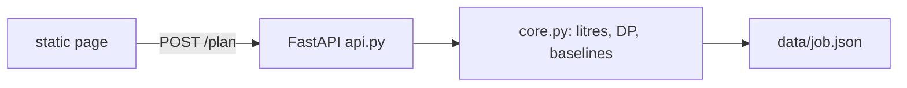

# Paint Can Planner


## Problem
Paint comes in 1, 2.5, 5 and 10 litre tins and big tins are cheaper per litre, but buying only the biggest wastes paint and buying only small tins costs more.

## Solution
Compute litres from wall areas (minus doors and windows), coats and coverage, then find the cheapest combination of tins covering at least that much with an unbounded-knapsack dynamic programme. Sample job (2 rooms, 2 coats, 10 m2 per litre = 13.9 L):

| Plan | Tins | Cost |
|---|---|---|
| Cheapest mix (DP) | 1 x 10 L + 1 x 5 L | $94 |
| Biggest tin only | 2 x 10 L | $120 |
| Smallest tin only | 14 x 1 L | $126 |

## Architecture


## Setup
```bash
pip install -r requirements-dev.txt
PYTHONPATH=src uvicorn paintcans.api:app --port 8000
PYTHONPATH=src pytest
docker build -t paintcans . && docker run -p 8000:8000 paintcans
```
Deploy: see [DEPLOY.md](DEPLOY.md) (Render or Hugging Face Spaces).

## Design decisions
- Exact DP over half-litre units: the optimum is cheap to compute and provably minimal (tested against brute force).
- Cover "at least" the need, never less: running short of paint mid-wall costs more than a little waste.
- Baselines shown beside the optimum: so the saving is visible, not asserted.
- Stateless API and invented prices: no personal data.

## Limitations
- No allowance for waste, primer, ceilings or different colours per room.
- Prices and coverage are invented; real tins vary by brand and surface.
- Sizes must be multiples of 0.5 L.

Data: invented, MIT licence.
