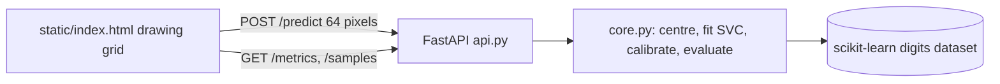

# Digit Sketchpad ("Chalk Digits")

Paint a digit on an 8 by 8 grid in the browser and watch a classifier guess it live, with probabilities for every digit.


## Problem
Handwritten-digit recognition is the classic first ML task, but most demos stop at a notebook accuracy number. This one serves the model behind an API and a drawing UI, and measures the thing that breaks real drawing: where on the grid the digit is placed.

## Solution
An RBF support-vector machine (probabilities from sigmoid calibration) trained on the 8x8 UCI optical-digits set (1,347 training images). Drawn digits are first shifted so their centre of mass is in the middle of the grid. On 450 held-out scans:

| model | clean accuracy | digit nudged 1 px diagonally |
|---|---|---|
| SVM with centring (shipped) | 97.1% | 81% |
| SVM without centring | 98.2% | 18% |
| plain logistic regression | 95.8% | not measured |

Centring costs about one point on clean scans but makes the classifier usable for hand-drawn input, where the digit is rarely perfectly placed.

## Architecture


## Setup
```bash
pip install -r requirements-dev.txt
PYTHONPATH=src uvicorn digitpad.api:app --reload   # http://localhost:8000 (trains in ~2 s at start)
pytest -q && ruff check .
docker build -t digitpad . && docker run -p 8000:8000 digitpad
```
Endpoints: `GET /health`, `GET /metrics`, `GET /samples`, `POST /predict`. Deploy: [DEPLOY.md](DEPLOY.md).

## Design decisions
- Centre of mass shift before the model: the clean-set accuracy barely changes but robustness to placement goes from 18% to 81% (measured on the test set, not assumed).
- SVM with feature scaling over a neural net: 1,800 tiny images do not need one, and it trains in about two seconds at startup, so no model files to ship.
- Sigmoid calibration for probabilities: raw SVM scores are not probabilities and the UI shows percentages.
- Train at startup, no saved model: nothing to version, and the container stays reproducible.
- Pixel values 0-16, validated at the API: the model expects that scale, and empty drawings get a clear 422.

## Limitations
- Training data are scanned digits resampled to 8x8; finger-painted digits look different and the model will make mistakes on them (it is a demo of the pipeline, not a production recogniser).
- Whole-pixel centring only: thin or very off-centre strokes can still fail.
- Only digits 0-9, one digit at a time.

## Data
"Optical Recognition of Handwritten Digits" (E. Alpaydin, C. Kaynak), UCI Machine Learning Repository, loaded through `sklearn.datasets.load_digits` (BSD-licensed scikit-learn distribution; CC BY 4.0 at UCI). No personal data.
