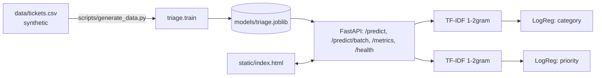

# Support Ticket Triage


Automatically **categorise and prioritise customer-support tickets** so urgent issues reach an agent first.


## Problem
Support teams receive hundreds of tickets a day. Manual sorting is slow, inconsistent and delays the tickets that matter ("production is down" sits behind "please add dark mode"). 

## Solution
A small NLP service that reads the subject + body of a ticket and returns:
- **category** (billing, technical, account, shipping, feature_request) with confidence,
- **priority** (low / medium / high / urgent) with confidence and a **suggested first-response SLA** (1h / 8h / 24h / 72h),
- the **key terms** that drove the category decision (explainability),
- a **batch mode**: upload a CSV and get tickets back sorted most urgent first.

Offline metrics on a held-out 20% split (synthetic data): category accuracy **0.96**, priority accuracy **0.99** (macro-F1 0.96 / 0.99). See limitations: these numbers describe template-generated data and are optimistic.

## Architecture


```
src/triage/   model.py (train/infer/explain/persist) · train.py (CLI) · api.py (FastAPI)
scripts/      generate_data.py (synthetic dataset)
static/       single-page UI (no build step)
tests/        model + API tests (pytest)
```

## Setup
```bash
python -m venv .venv && source .venv/bin/activate
pip install -r requirements-dev.txt
python -m triage.train            # optional; the API trains on first start if no model exists (PYTHONPATH=src)
PYTHONPATH=src uvicorn triage.api:app --reload   # http://localhost:8000  (API docs at /docs)
pytest -q && ruff check .
```
Docker: `docker build -t ticket-triage . && docker run --rm -p 8000:8000 ticket-triage`.
Deploy: see [DEPLOY.md](DEPLOY.md) (Render / Hugging Face Spaces).

API example:
```bash
curl -s localhost:8000/predict -H 'content-type: application/json' \
  -d '{"subject":"Charged twice","body":"I was billed twice, please refund. This is urgent."}'
```

## Design decisions
- **TF-IDF + logistic regression, not a transformer** — fast, tiny, trains in under a second, runs on a free CPU host, and is directly explainable via coefficients.
- **Two independent classifiers (category, priority)** — the labels depend on different cues (topic vs. tone/urgency words); separate models are simpler to evaluate and tune.
- **Subject repeated in the text** — cheap way to up-weight the short, high-signal subject line.
- **SLA is a lookup table on predicted priority** — business rules stay explicit and auditable rather than learned.
- **Model trained at Docker build time** — reproducible image, instant start, no runtime writes.
- **API trains on first start if the artifact is missing** — works out of the box on any host with zero setup.
- **Synthetic data generated by a seeded script** — no personal data, fully reproducible, licence-free (CC0; generated by this repo).
- **Batch endpoint capped at 500 rows, validated CSV** — protects a small free instance from abuse.
- **Static HTML UI, no framework** — nothing to build, readable in a minute.

## Dataset
Synthetic, generated by `scripts/generate_data.py` (seed 42; 1,200 tickets; 3% label noise injected). No real customer data; released under CC0.

## Limitations
- Data is template-generated, so real-world accuracy would be lower; the pipeline is the deliverable, retrain on real labelled tickets via `python -m triage.train --data your.csv` (columns `subject,body,category,priority`).
- English only; no handling of attachments, threads or sentiment beyond n-grams.
- Priority is predicted from text only (no customer tier, order value, or repeat-contact signal).
- Free-tier hosts sleep when idle (cold starts).

## License
MIT.
