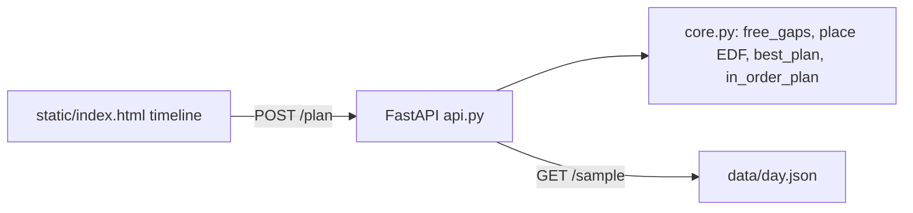

# Day Timebox Planner ("Day Boxes")

Give it your day's fixed meetings and a task list with priorities and deadlines; it picks the most valuable set of tasks that genuinely fits and draws them on a timeline.


## Problem
To-do lists ignore the clock. Working down a list in the order written wastes the small gaps between meetings on low-value chores and leaves the important, deadline-bound tasks without room.

## Solution
Subtract the fixed events from the day window to get the free gaps. A set of tasks is *feasible* if an earliest-deadline-first pass can place every task, whole, before its deadline (with a small buffer after each task). The planner enumerates every subset of up to 14 tasks and returns the feasible one with the highest total priority, breaking ties toward fewer minutes. On the sample day (9 tasks, 4 meetings, 6.25 free hours) it schedules 7 tasks worth 25 priority points; doing the tasks in the order written yields 19.

## Architecture


## Setup
```bash
pip install -r requirements-dev.txt
PYTHONPATH=src uvicorn timebox.api:app --reload   # http://localhost:8000
pytest -q && ruff check .
docker build -t timebox . && docker run -p 8000:8000 timebox
```
Endpoints: `GET /health`, `GET /sample`, `POST /plan`. Deploy: [DEPLOY.md](DEPLOY.md).

## Design decisions
- Exact subset search up to 14 tasks: 2^14 subsets is instant, and it guarantees the best set under the placement rule (checked against brute force on random days).
- Earliest-deadline-first placement into the first gap that fits: the classic rule for meeting deadlines, simple to explain.
- Whole tasks only (no splitting): context-switching makes split tasks less useful, and it keeps the schedule readable.
- Priority 1-5 as value, ties broken toward less time: when two plans are equally valuable the freer day wins.
- Honest baseline: "in the order written" (add a task only if the day still works), not "do nothing".

## Limitations
- Selection is exact, but placement is first-fit, so a set that could fit with cleverer packing may be rejected.
- Priority is the only value signal: a 5-minute and a 2-hour task of equal priority count the same.
- No energy curve, no travel time, one day at a time; at most 14 tasks.

## Data
`data/day.json`: an invented day; MIT with the repo.
