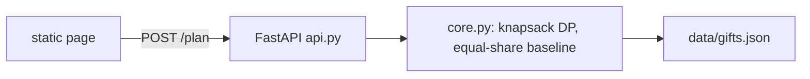

# Gift Budget Splitter


## Problem
You have one gift budget and several people. Giving everyone the same allowance wastes money on people with cheap options and starves those with a great gift just above the limit.

## Solution
A multiple-choice knapsack DP picks at most one gift per person to maximise total joy within the budget. Sample (5 people, $120):

| Plan | Total joy | Spent |
|---|---|---|
| Best joy for the budget (DP) | 32 | $117 |
| Equal allowance ($24 each) | 24 | $65 |

## Architecture


## Setup
```bash
pip install -r requirements-dev.txt
PYTHONPATH=src uvicorn giftbudget.api:app --port 8000
PYTHONPATH=src pytest
docker build -t giftbudget . && docker run -p 8000:8000 giftbudget
```
Deploy: see [DEPLOY.md](DEPLOY.md) (Render or Hugging Face Spaces).

## Design decisions
- Exact DP over whole dollars: optimal and fast for realistic budgets (checked against brute force).
- At most one gift per person: keeps the problem a clean multiple-choice knapsack.
- Equal-allowance baseline shown beside the optimum: it is what most people do by default.
- Stateless API, invented data: nothing personal stored.

## Limitations
- Joy scores are your own guesses; the maths cannot fix bad inputs.
- Whole-dollar prices only; budget capped at 2000.
- No fairness constraint: the optimum can favour some people.

Data: invented, MIT licence.
