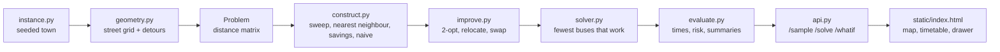

# School Bus Route Planner

## Why does Bus 4 take 58 minutes?

In a small district, one bus often ends up with the long, winding route: it picks up a few kids near the river, loops around the closed road, and reaches school with half its seats empty while another bus is full. Parents see the ride time. Administrators see the bus count. Neither sees why.

This tool plans the morning run for a made-up town of 120 stops and 258 students. It shows every bus on a map, lists pick-up times counted back from the bell, flags the stops at risk of a ride that is too long (and says why), and answers "what if we lose a bus, or the bridge closes?" in a few seconds.


## Before and after

Sample town (seed 7), 8 buses of 36 seats, 45 minute ride limit, bell at 8:15. The naive plan drives one nearest-stop-first tour and slices it into buses whenever one fills up.

| Measure | Naive plan | Savings baseline | This planner |
| --- | --- | --- | --- |
| Buses on the road | 8 | 10 | 8 |
| Total distance | 144.4 km | 110.4 km | **104.4 km** (27.7% less) |
| Longest student ride | 60 min | 43 min | **41 min** |
| Stops over the 45 minute limit | 12 | 0 | **0** |

Removing one bus leaves 252 seats for 258 students, so the planner reports the 6 students who would have no seat instead of hiding it.

## How the solver works

1. **Group.** Stops are sorted by angle around the school and cut into loads that fit a bus (a sweep). Several start angles are tried. Clarke-Wright savings, adapted to a trip that ends at school, is tried as another start.
2. **Order.** Within each group, a bus starts at the farthest stop and drives to the nearest unvisited stop each time (nearest neighbour), then each route is tidied with 2-opt, which only accepts a change that shortens the route without making any student's ride later than allowed.
3. **Polish.** Relocate and swap moves shift stops between buses, always respecting capacity. Late minutes over the ride limit cost 8 km each, so a plan with a long ride loses to one without. The planner tries the fewest buses that could work first and only adds buses if rides cannot fit.

Pick-up times are worked backwards: the bus reaches school 5 minutes before the bell, and each stop is the travel and boarding time (0.4 min plus 0.1 per student) earlier than the next. Road distance comes from a breadth-first search on a street grid with the river and closed roads removed, so detours are real.

## Architecture



## Run it

```bash
pip install -r requirements-dev.txt
PYTHONPATH=src uvicorn busroutes.api:app --port 8000   # open http://localhost:8000
pytest -q && ruff check .
```

API: `GET /health`, `GET /sample`, `POST /solve` (seed, buses, capacity, ride limit, closed roads), `POST /whatif` (`{"base": {}, "change": {"buses": 7}}` returns before, after, delta and a plain verdict). Closable road ids: `bridge-north`, `bridge-central`, `bridge-south`, `oak-avenue`, `market-street`.

Docker: `docker build -t bus-planner . && docker run -p 8000:8000 bus-planner`.

## Design decisions

- Map first, because administrators and parents think in places, not tables.
- Timetable as a left rail of collapsible sheets, so a parent finds one bus and one time.
- What-if as a right drawer with steppers and a close-road toggle, so every change is one tap and the plan re-solves at once.
- Routes differ by colour, dash pattern and numbered badge, so colour is never the only cue.
- Late stops get the word "over" and a reason in plain text, not only a colour.
- Draw-on entrance plays once on load and is off under reduced motion.
- Pure Python and a precomputed distance matrix: no solver dependency, runs on a free host.
- Visual system dealt with taste-skill: palette walnut-tan, type host (Host Grotesk with JetBrains Mono for times), soft radius, plus a deeper-brown light mode.

## Dataset

`data/sample_town.json` is generated by `scripts/make_sample.py` from a seed. The town, stop codes (S001...) and student codes (P1234...) are fictional; there are no names or addresses. CC0.

## Limitations

- One speed (30 km/h) and one rule for boarding time; no traffic, hills or school zones.
- Buses start at their first stop; the drive from the depot is not counted.
- One school, one bell, one pass of morning pick-ups; afternoon runs, special needs and mixed bus sizes are out of scope.
- Stops sit on street intersections, and rides are counted from arrival at the stop.
- A local-search heuristic: good plans, not proven optimal.

## Deploy

See [DEPLOY.md](DEPLOY.md) for Render and Hugging Face Spaces. MIT licence.
