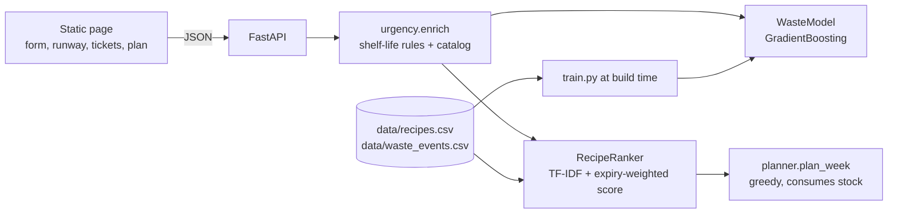

# Pantry Saver

## Why this exists

Households throw away roughly a quarter to a third of the food they buy, and most of it is not mysterious leftovers: it is the spinach that turned in the drawer, the milk nobody got to, the bread that went hard. At a few kilograms and a few currency units per week, that adds up to hundreds of units per year per household. People do not waste food because they do not care; they waste it because nobody is tracking what expires when, and "what can I make with this?" is a hard question at 6 pm.

Pantry Saver answers it. List what you have with its best-before date, and it tells you what to use first, which recipes use those items, and how to spread them over a week, with an estimate of the kilograms and money kept out of the bin.


## Solution

1. **Urgency ranking.** Each item gets a 0-1 urgency: `0.7 * time_urgency(days_left) + 0.3 * P(wasted)`. Time urgency decays exponentially (1.0 when due, about 0.72 at 1 day, 0.37 at 3 days, 0.1 at 7). `P(wasted)` comes from a small scikit-learn model fed category, storage, days since purchase and household size. Missing best-before dates are estimated from category-specific shelf-life rules.
2. **Recipe matching.** About 60 original recipes (`data/recipes.csv`) are scored as `sum(urgency of used items) - 0.35 * missing ingredients + 0.5 * TF-IDF cosine(pantry, recipe)`. Expired items are never suggested.
3. **Waste avoided.** Items with 3 days or fewer left that a recipe uses count as "saved"; kilograms and money come from a small weight/price table.
4. **Weekly plan.** Greedy day-by-day selection: each day takes the best-scoring recipe given the stock left and how urgent it has become by then; used amounts are consumed, recipes never repeat, days with nothing worthwhile are left open.

## Architecture



## Endpoints

| Method | Path | Purpose |
|---|---|---|
| GET | `/health` | liveness |
| GET | `/metrics` | waste-model quality (AUC, Brier vs baseline), recipe count |
| GET | `/sample` | a sample shelf with dates relative to today |
| POST | `/prioritize` | items ranked by urgency with days left and bin risk |
| POST | `/recipes` | top recipes, what they use and miss, kg and money saved |
| POST | `/plan` | up to 14 days of dinners, total kg and money, items still at risk |

## Setup

```bash
python -m venv .venv && . .venv/bin/activate
pip install -r requirements-dev.txt
PYTHONPATH=src python -m pantry.train      # trains models/waste.joblib (also happens on first start)
PYTHONPATH=src uvicorn pantry.api:app --port 8000   # http://localhost:8000
ruff check . && pytest -q
```

Docker: `docker build -t pantry-saver . && docker run --rm -p 8000:8000 pantry-saver`. See [DEPLOY.md](DEPLOY.md) for Render and Hugging Face Spaces.

## Dataset

Everything is **synthetic or original**. `data/waste_events.csv` (6000 rows) is generated by `scripts/generate_data.py` from a hand-written behavioural rule (perishables and long storage raise waste risk, bigger households use food faster) plus noise. `data/recipes.csv` is 60 recipes written for this project, with no scraped data. Prices, weights and shelf lives in `src/pantry/catalog.py` are rough approximations in a generic currency, not sourced figures. No personal data is used. On held-out synthetic data the waste model reaches ROC AUC about 0.89 and Brier 0.128 against a 0.223 base-rate baseline; because the labels come from the same rule the model learns, those numbers show the pipeline works, not real-world accuracy.

## Design decisions

- **Exponential time decay for urgency**: the cost of waiting falls off fast after a few days, so a smooth decay beats hard buckets.
- **Blend 70% time, 30% ML probability**: expiry date stays the dominant, explainable signal while the model nudges fragile categories (leafy greens, fish) up.
- **Gradient boosting for the waste model**: tabular mix of categorical and numeric features, handles interactions (category x days held) with no tuning.
- **TF-IDF over ingredient sets**: rare ingredients (feta) say more about a match than common ones (onion), and it gives a cheap similarity term without embeddings.
- **Penalise missing ingredients per item**: a recipe that needs a shopping trip should lose to one cooked from what is already there.
- **Staples assumed on hand**: salt, oil, flour and sugar are never "missing", otherwise every recipe is penalised equally for nothing.
- **Never recommend expired food**: safety first; expired items are shown last and flagged, not cooked.
- **Greedy planner with stock consumption**: 7 picks from 60 recipes does not need an exact knapsack, and greedy keeps results explainable day by day.
- **Minimum plan score**: a day with nothing worthwhile is left open rather than padded with a recipe that needs a full shop.
- **"Saved" only counts items with 3 days or fewer left**: using a carton with two weeks left does not prevent any waste.
- **Model trained at build time**: the image starts instantly and is reproducible; the API also trains on first start if no artifact exists.
- **Visual system dealt with taste-skill**: palette `offwhite-bottle-yellow` (bottle-green ink, yellow fills), type pair Gabarito + Figtree, round radius; yellow is only ever a fill, accent text uses the ink green (light) or yellow (dark) for contrast.
- **Runway bars from real days left**: bar length is days left on a 0 to 14 day scale, so urgency is visible without reading a number.
- **Plain static page, no build step**: one HTML file with inline CSS and JS, tokens at the top, `prefers-color-scheme` aware, `prefers-reduced-motion` respected.

## Limitations

- Shelf-life rules are generic; real food depends on packaging, temperature and whether it was opened. Always trust your eyes and the printed date.
- Quantities are in "units" mapped to typical weights, so kg and money are estimates.
- The waste model is trained on synthetic data and has not been validated against real households.
- Recipes are a small set of 60, matched by exact ingredient names; dietary filters and substitutions are not modelled.
- The greedy planner is not optimal and plans dinners only.
- Item names are matched against a built-in catalog of about 60 ingredients; unknown items are listed but not used in recipes.
- No accounts: the page keeps the shelf in browser local storage only.

## License

MIT, see [LICENSE](LICENSE).
