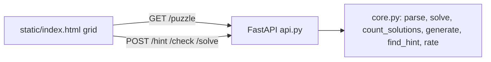

# Sudoku Coach

Generated Sudoku puzzles with exactly one solution, rated easy / medium / hard by the technique they need, and hints that explain why a digit goes where it does.


## Problem
Most Sudoku apps either hand you a puzzle and a "reveal" button, or a hint that just fills a cell. A learner needs to know *why*, and to know whether a puzzle is hard because it needs a harder technique or just because it has few clues.

## Solution
- **Generator:** build a random full grid with randomised backtracking, then remove digits one at a time, keeping a removal only if the puzzle still has exactly one solution (checked by a solution counter capped at 2), until the requested number of clues remains. Puzzles are reproducible from a seed.
- **Solver:** backtracking with minimum-remaining-values; also counts solutions and detects unsolvable grids.
- **Coach:** the next logical move is a *naked single* (a cell with one possible digit) or a *hidden single* (a digit with one possible cell in a row, column or box), with a plain-language reason.
- **Rating:** the weakest technique that finishes the puzzle without guessing. Easy needs naked singles only, medium needs hidden singles too, hard needs guessing. Generated at 30 clues across 25 seeds, the ratings include both medium and hard.

## Architecture


## Setup
```bash
pip install -r requirements-dev.txt
PYTHONPATH=src uvicorn sudokucoach.api:app --reload   # http://localhost:8000
pytest -q && ruff check .
docker build -t sudokucoach . && docker run -p 8000:8000 sudokucoach
```
Endpoints: `GET /health`, `GET /puzzle?seed=&clues=`, `POST /hint`, `POST /solve`, `POST /check`. Deploy: [DEPLOY.md](DEPLOY.md).

## Design decisions
- Uniqueness by solution counting while generating: a puzzle with two solutions is a bug, not a puzzle.
- Rate by technique, not by clue count: clue count is a poor proxy (tests show 30-clue puzzles at easy, medium and hard).
- Only two human techniques: singles cover the large majority of puzzles and are the right things to teach first; anything else is labelled "hard" and honestly needs a guess.
- Hints return a reason string, not just a cell: the explanation is the product.
- Stateless server, grid string in each request: nothing stored.

## Limitations
- No pairs, pointing pairs or X-wings, so "hard" includes puzzles a human would solve with those techniques.
- Difficulty depends on the order of the hint search, so it is a rating of this coach's method, not a universal one.
- Standard 9x9 only.

## Data
No dataset: puzzles are generated. Tests use the widely published example grid from the Sudoku Wikipedia article for solver correctness.
