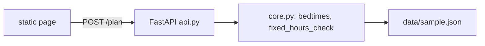

# Sleep Cycle Planner


## Problem
"Sleep 8 hours" can still leave you groggy: if the alarm rings in the middle of a sleep cycle you wake from deep sleep.

## Solution
Count back from the wake-up time in whole 90-minute cycles, plus the minutes it takes to fall asleep, and list the in-bed times. Sample (wake 06:45, 15 min to fall asleep):

| Cycles | Asleep | In bed |
|---|---|---|
| 6 | 9 h | 21:30 |
| 5 | 7.5 h | 23:00 |
| 4 | 6 h | 00:30 |
| 3 | 4.5 h | 02:00 |

A plain 8-hour bedtime (22:45) wakes you 15 min into a cycle.

## Architecture


## Setup
```bash
pip install -r requirements-dev.txt
PYTHONPATH=src uvicorn sleepcycle.api:app --port 8000
PYTHONPATH=src pytest
docker build -t sleepcycle . && docker run -p 8000:8000 sleepcycle
```
Deploy: see [DEPLOY.md](DEPLOY.md) (Render or Hugging Face Spaces).

## Design decisions
- Whole 90-minute cycles: the common rule of thumb, and configurable (60-120 min).
- Fall-asleep latency is an input: it differs a lot between people.
- Times wrap past midnight with modular arithmetic: bedtimes like 00:30 stay correct.
- Stateless API, no stored data: nothing personal kept.

## Limitations
- Cycle length varies by person and night; 90 minutes is an average, not a measurement.
- Not medical advice; it does not detect sleep stages.
- Assumes one wake-up time and no naps.

Data: invented, MIT licence.
