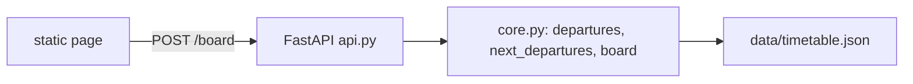

# Next Bus Finder


## Problem
Timetables list first bus, last bus and "every 20 minutes". Working out the next bus you can actually catch, after the walk to the stop and after the last bus has gone, is fiddly, especially for night routes that run past midnight.

## Solution
Generate each route's departures from first time, last time and headway, add the walk time to "now", and show the next three departures per route, flagging the last bus and marking tomorrow's. Sample (invented routes, now 22:40, 6-minute walk): 12 Harbour 22:50, N3 Night 23:15, and 7 University only tomorrow at 06:00 because its last bus (22:45) leaves before you arrive.

## Architecture


## Setup
```bash
pip install -r requirements-dev.txt
PYTHONPATH=src uvicorn busfind.api:app --port 8000
PYTHONPATH=src pytest
docker build -t busfind . && docker run -p 8000:8000 busfind
```
Deploy: see [DEPLOY.md](DEPLOY.md) (Render or Hugging Face Spaces).

## Design decisions
- Headway-based timetable (first, last, every N minutes): the smallest data a route needs; no need for a full schedule file.
- A `last` earlier than `first` means the route runs past midnight: how night buses are normally listed.
- Departures from yesterday, today and tomorrow are pooled: so a route that has finished shows tomorrow's first bus and an after-midnight bus still counts.
- `now` is an input, not the system clock: results are reproducible and testable.

## Limitations
- One service pattern per route; no weekend or holiday variations.
- Real buses run late; this uses the printed timetable only.
- Routes and times are invented.

Data: invented, MIT licence.
